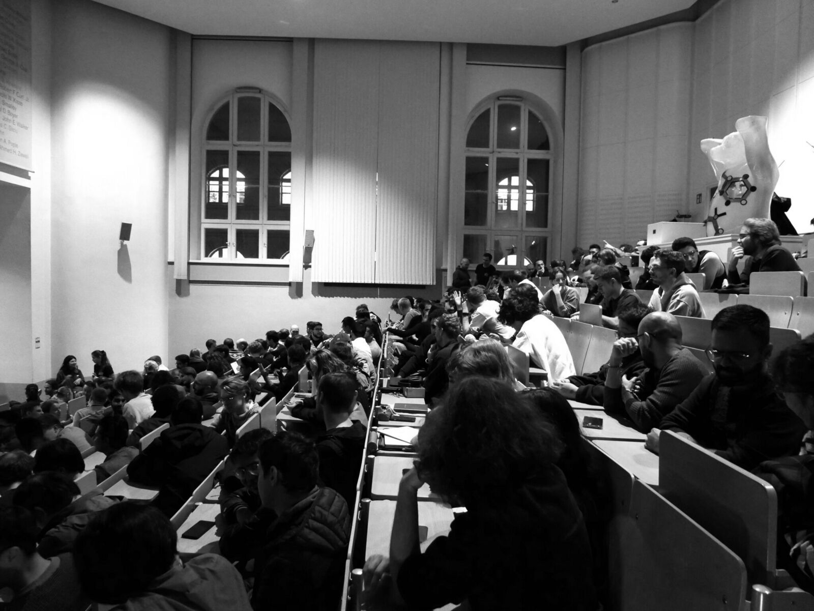

From October to February, we hosted a talk every two weeks at TU Berlin. On 10 February, Ahmed Salem (Microsoft Security Response Center) closed the semester. He showed which risks appear when LLMs become agents that take actions, from prompt injection to safety evaluations that are harder than they look. As always, the discussion continued over pizza and drinks.

Missed a talk? All eight recordings are on our [YouTube channel](https://www.youtube.com/@bliss.ev.berlin):

- **Federico Barbero** (Google DeepMind, University of Oxford): [Why do LLMs struggle with Long Context?](https://www.youtube.com/watch?v=Dsl2bD6akkM)
- **Beyza Ermiş** (Cohere): [Scaling AI Safety Across Cultures and Languages](https://www.youtube.com/watch?v=ECS0Rez1AeA)
- **Ashley Edwards** (Google DeepMind): [Generative World Models](https://www.youtube.com/watch?v=e6echhvqxhM)
- **Ameya Prabhu** (Tübingen AI Center): [What's Next in Continual Learning for Foundation Models?](https://www.youtube.com/watch?v=2Bfvmi4ySBs)
- **Dilara Gökay** (Google DeepMind): [Insights into Training Video Models](https://www.youtube.com/watch?v=qJVkC47kWnc)
- **Jonas Hübotter** (ETH Zurich): [Test-Time Training Agents for Deep Exploration](https://www.youtube.com/watch?v=7EsrcXXPBRU)
- **David Watson** (King's College London): [Can Humans Flourish in the Age of AI?](https://www.youtube.com/watch?v=nwPhpFjQqAE)
- **Ahmed Salem** (Microsoft Security Response Center): [The Price of Intelligence: Three Risks Inherent in LLMs](https://www.youtube.com/watch?v=FbaaKi1cgWg)

Thank you to all speakers and to everyone who came! Abstracts and photos of all past talks are on the [Speaker Series page](/speaker-series).
