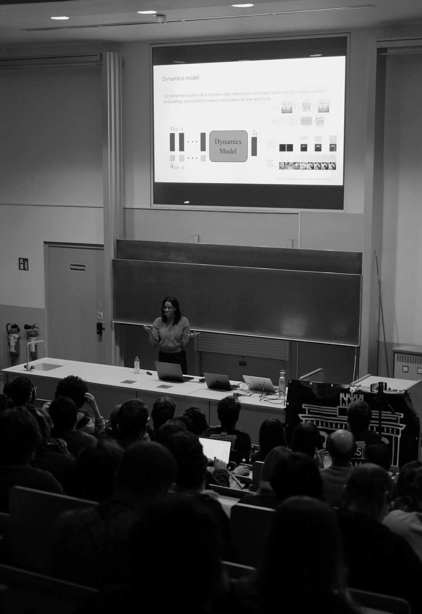

In the winter semester 2025/26 we hosted eight talks in our Speaker Series. The lecture halls were full on most evenings.

- **Federico Barbero** (Google DeepMind, University of Oxford) – Why do LLMs struggle with Long Context?
- **Beyza Ermiş** (Cohere) – Scaling AI Safety Across Cultures and Languages
- **Ashley Edwards** (Google DeepMind) – Generative World Models
- **Ameya Prabhu** (Tübingen AI Center) – What's Next in Continual Learning for Foundation Models?
- **Dilara Gökay** (Google DeepMind) – Insights into Training Video Models
- **Jonas Hübotter** (ETH Zurich) – Test-Time Training Agents for Deep Exploration
- **David Watson** (King's College London) – Can Humans Flourish in the Age of AI?
- **Ahmed Salem** (Microsoft Security Response Center) – The Price of Intelligence: Three Risks Inherent in LLMs

See all past talks on the [Speaker Series page](/speaker-series).
