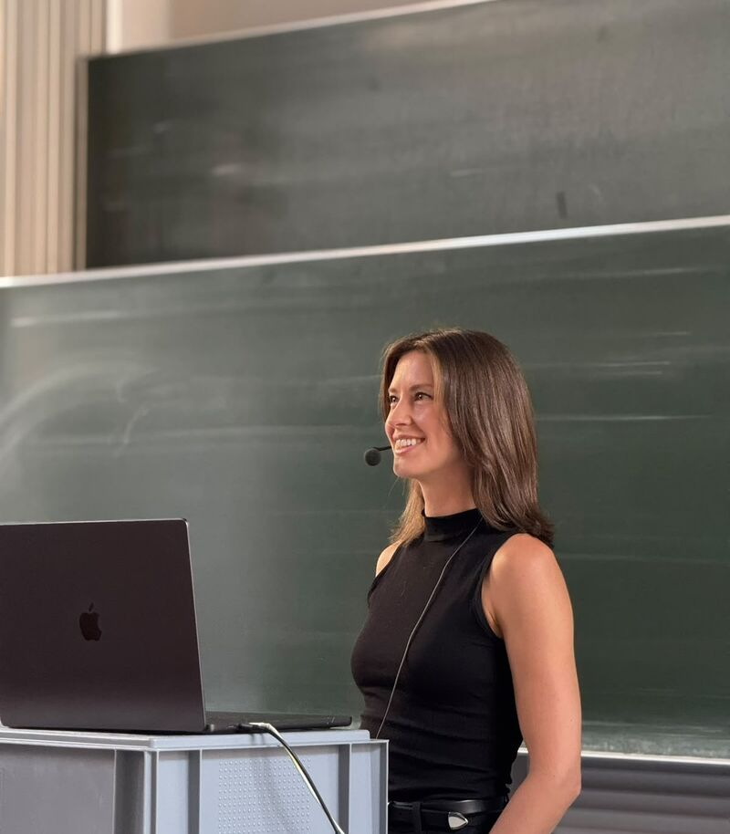

Our Speaker Series in the summer semester 2026 had seven talks with guests from Hugging Face, Cohere Labs, the University of Oxford, ETH Zürich and Stanford University.

- **Nouamane Tazi** (Hugging Face) – Scaling LLM Training to Thousands of GPUs
- **Marzieh Fadaee** (Cohere Labs) – Scaling LLMs Across Languages
- **Christopher Summerfield** (University of Oxford) – AI and Human Agency
- **Georgia Channing** (Hugging Face) – When Silicon Meets Carbon: Bringing Synthetic Biology to Life
- **Thomas Wimmer** (ETH Zürich) – Beyond Patches: Learning Dense Visual Features
- **Fazl Barez** (University of Oxford) – Towards Automated Interpretability for AI Safety
- **Sophia Sanborn** (Stanford University) – Virtual Neuroscience with Neural Digital Twins

Recordings of many talks are on our [YouTube channel](https://www.youtube.com/@bliss.ev.berlin). All past talks are listed on the [Speaker Series page](/speaker-series).
